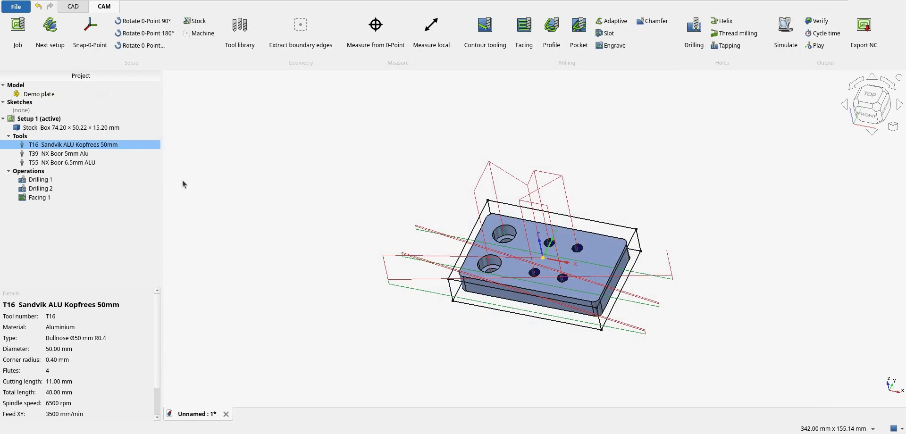
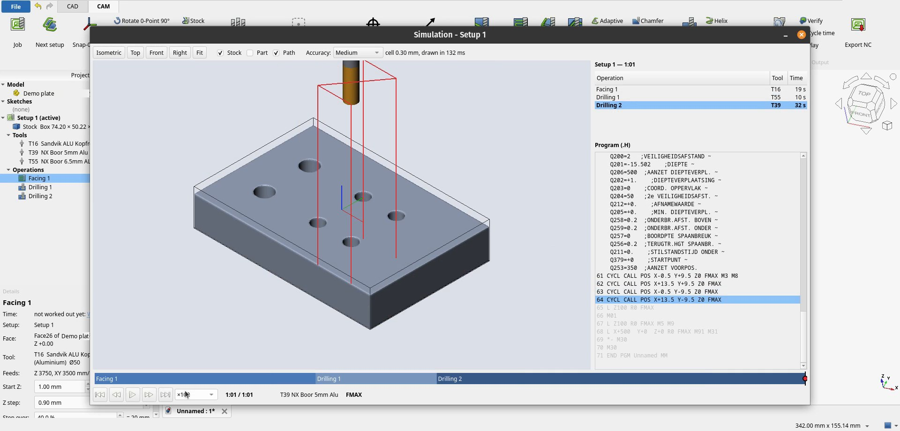
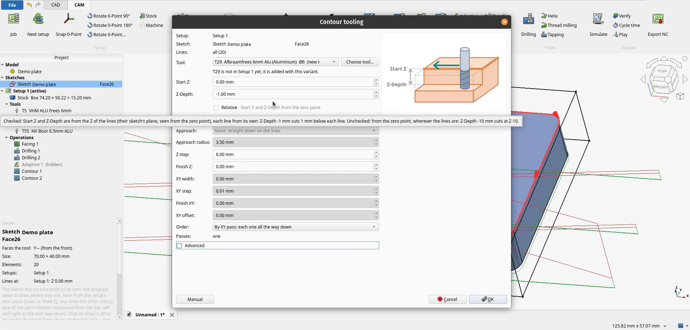
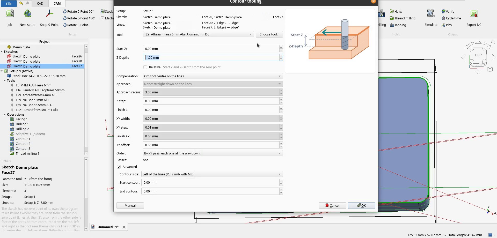
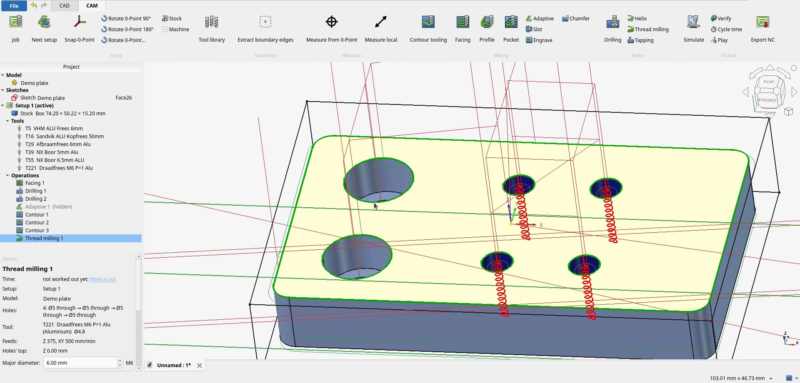
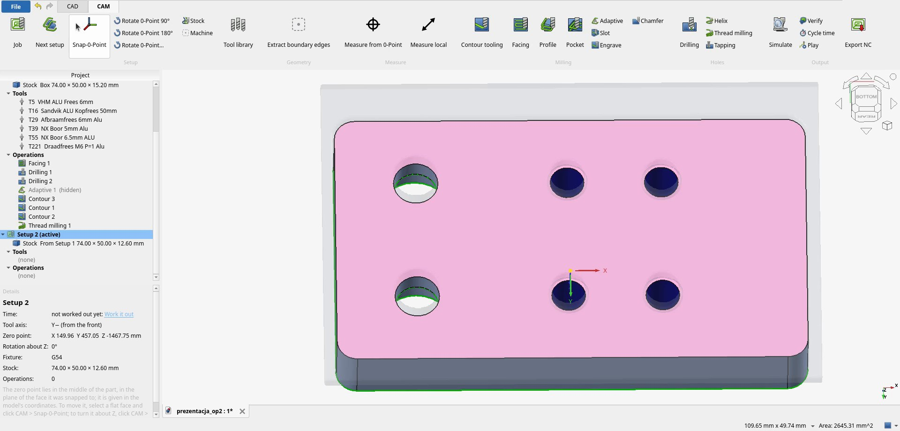

# AvangardeCam — step-by-step manual

*Polska wersja: [README.pl.md](README.pl.md)*

This manual takes one part from the 3D model to a Heidenhain program (`.H`).
The example is a simple demo plate (70 × 40 × 10 mm, aluminium):
two counterbores for screw heads and four M6 holes, machined in two clampings.

## Contents

1. [The interface](#1-the-interface)
2. [Setup and Stock](#2-setup-and-stock)
3. [Drilling from the 3D model](#3-drilling-from-the-3d-model)
4. [Facing](#4-facing)
5. [The operation list](#5-the-operation-list)
6. [Simulation — Simulate](#6-simulation--simulate)
7. [Adaptive clearing](#7-adaptive-clearing)
8. [A sketch from the edges and picking lines](#8-a-sketch-from-the-edges-and-picking-lines)
9. [Contour tooling](#9-contour-tooling)
10. [Thread milling](#10-thread-milling)
11. [The second clamping — Next setup](#11-the-second-clamping--next-setup)
12. [NC program and checks](#12-nc-program-and-checks)

---

## 1. The interface

- **CAM ribbon** (top), in groups:
  - **Setup:** Job, Next setup, Snap-0-Point, Move 0-Point, Set 0-Point as default, Reset 0-Point, zero rotation, Stock, Custom stock, Tool library;
  - **Geometry:** Extract boundary edges;
  - **Measure:** measuring;
  - **Milling:** Contour tooling, Facing, Adaptive…;
  - **Holes:** Drilling, Helix, Thread milling;
  - **Output:** Simulate, Verify, Cycle time, FreeCAD sim, Export NC.
- **Project tree** (left): Model, Sketches, and in each Setup its Stock, Tools and Operations.
- **Details** (under the tree): what the selected item is. The main fields can be changed here without opening its window.
- **3D view:** a click selects faces, edges and sketch lines. The red line is the tool path of the selected operation.

Every operation window has a **Manual** button with the full description of how that operation works.

**Typing numbers:** a click in a number box puts the cursor in the number, never behind its unit (mm, °, rpm): change one digit at once. A double click selects the whole number, so what you type replaces it. A box that shows **none** or **-** is selected at a click.

**View navigation (Blender style):** middle button rotates, Shift+middle pans, Ctrl+middle zooms.

---

## 2. Setup and Stock

### Setup

Click **Job**. **Setup 1 (active)** appears in the tree: the first clamping, with Stock, Tools and Operations.

The zero point starts on top of the model, in the middle. To move it:

- select a flat face and click **Snap-0-Point**: Z points out of the face, X0 Y0 lands in the middle of the part;
- **Rotate 0-Point 90° / 180° / …** turns the zero point about Z.

#### Moving the zero point within a setup

> This part is new. Check the first programs with a moved zero point on the control's own simulation and with a dry run.

The zero point Snap-0-Point gives is the setup's **default zero point**: the machine's preset. **Move 0-Point** moves the zero point away from it, and **every operation keeps the zero point it was made on**: operations made before the move stay as they are, new ones count from where the zero point was left. In the program each operation's zero point is given from the default one (a datum shift, `CYCL DEF 7`).

- **Move 0-Point**: in its window click **Select wall**, then a flat face of the part: the zero point goes the shortest way onto that face (a wall square to X changes X only; a second wall adds to the first, so two or three walls give a corner). Or click **Select circle**, then a round edge of the part or the wall of a round hole or pin: the zero point goes to the middle of the circle at the mouth of the hole, where a tool comes in from outside the part (a click deep in a hole, even on its far edge, still gives its mouth; of a hole through a plate, the end you clicked). Or type how far it moves in **Move X / Y / Z**. The 3D view shows where the zero point would be; **OK** moves it.
- **A hole to set up from**: in a second setup, **Select circle** on a hole milled from the top in the first one, then **Set 0-Point as default**: the preset is the middle of the hole at its top, which a probe on the machine finds quickly. Without 5 axes the zero point only moves: for a circle whose axis is not along Z (a hole in a side wall) it goes to its middle and Z stays as it is.
- **Set 0-Point as default**: the zero point as it stands becomes the default one (the preset).
- **Reset 0-Point**: the zero point goes back to the default one.
- **Make 0-Point active** (right click on an operation): the zero point goes to the one that operation counts from, to change it or to add operations there. An operation on another zero point is marked *(other 0-Point)* in the tree; **Edit…** on it makes its zero point active first.

Snap-0-Point and Rotate 0-Point move the whole setup (its default zero point with the operations on it); use them while the zero point is on the default one.

The **stock has a zero point of its own**: the default one. It is one block, wherever the zero point stands. You can change it on any zero point: what you type in the Stock window is counted back to the default zero point.

The 3D view, its navigation cube and the Top / Front / Right views always follow the zero point that is active.

**Simulate, Verify and Cycle time** run every operation from its own zero point, as the program does.

### Stock

Click **Stock** on the ribbon. The stock is the model's box plus an allowance on each side.

| Field | Meaning |
| --- | --- |
| Size X / Y / Z | Size of the raw block. The model stays in the middle. |
| Allowance X− / X+ / Y− / Y+ | Allowance on each side separately. |
| Allowance bottom (Z−) | Material under the model (e.g. removed in the second clamping). |
| Allowance top (Z+) | Material above the model (removed by Facing). |

**OK** applies the changes. In the example the stock is 74.20 × 50.22 × 15.20 mm.

### Custom stock

When the part is machined from a casting, a sawn block or a blank machined before, click **Custom stock** on the ribbon (also **Custom stock...** in the Stock window and in the stock's details) and choose its STEP, IGES, BREP or STL file. **Put the middle of the stock in the middle of the model** (ticked at first) moves the blank so that the middle of its box is on the middle of the model's box: the file may draw it anywhere. A blank the file already draws around the model stays there (the foundry's allowances where it put them, e.g. only under the part). Unticked, it always stays where the file draws it, in the part's coordinates. The blank is only moved, never turned: if the model sticks out of it (a blank too small, or lying the other way), a message says by how much on which side. The details show the file and where the blank's middle is; **Put in the middle** puts it there later. A right click on the stock in the list opens its menu: **Move stock...** moves the blank along X, Y and Z of the setup, **Put in the middle**, **Custom stock...**, **Stock...**. **Replace by box with allowances** goes back to a box. Simulate and Verify start from the blank's material.

### Tool library

**Tool library** on the ribbon lists the shop's tools, each T number once per workpiece material (its own spindle speed and feeds). **Add to project** puts the selected tools into the active setup. Under the table:

- **New tool...** opens an empty tool with the lowest free T number. Choose its **Type**: the window shows FreeCAD's drawing of it and only its fields, named with the drawing's letters (Diameter (D), Corner radius (R), Cutting length (H), Length out of the holder (L), Shank diameter (S), ...). Fill in the spindle speed and both feeds; Vc and fz are worked out beside them. **OK** says what is missing or wrong and keeps the window open.
- **Edit...** changes the selected tool. When the open project has it, AvangardeCam asks whether to change it there too: its operations get the new geometry, spindle speed and feeds (an operation's own speed and feeds stay).
- **Duplicate...** copies the selected tool, e.g. for another workpiece material under the same T number. The window lists the other tools of the library under that number.
- **Delete** takes the selected tool out of the library; a project keeps its own copy.

The library shipped with AvangardeCam is replaced by every update, so the first change copies it into your own file in FreeCAD's user folder (`AvangardeCam/tools.json`), used from then on. A library opened with **Open other library...** is changed where it is.

**Tools from your old program.** The library is a plain JSON file: its format is described at the top of `avangardecam/model/library.py`, and `Resources/library/tools.json` is a full example. An AI coding assistant such as Claude Code can probably turn your old program's tool table (its export, a CSV or a spreadsheet) into this format quickly: give it your table and these two files and ask for an AvangardeCam tool library. Open the result with **Open other library...**; a file that cannot be read is refused with the reason. Check a few tools (diameter, lengths, spindle speed and feeds) before you cut with them: **Edit...** and **OK** on a tool also says what is wrong with it.

---

## 3. Drilling from the 3D model

Holes are drilled straight from the model: the diameter and depth are read from it. The program uses **CYCL 205** (deep drilling with chip breaking).

1. Click the wall of a hole in the 3D view. Add more holes with **Shift+click**.
   The click order is the drilling order.
2. Click **Drilling**.
3. Pick a drill from the list, or from the tool library with **Choose tool…**.
   A tool that is not in the setup yet is added to it.
4. Click **OK**.

| Field | Meaning |
| --- | --- |
| Depth (Q201) + From the model | Ticked: each hole as deep as the model has it. Unticked: a negative depth from the top of the hole (−10 = 10 mm deep). |
| Out under through holes | How far the drill comes out under a through hole. |
| Peck depth (Q202) | How often the drill leaves the hole (0 = the whole depth at once). |
| Chip break depth (Q257) | How often it backs off to break the chip (0 = never). |
| Chip break retract (Q256) | How far it backs off when breaking the chip. |
| Dwell at bottom (Q211) | Dwell time at the bottom. |

The line **The tip goes** shows how deep the drill tip goes, including its point.

The example has two drilling operations: **Drilling 1** (Ø6.5 drill in the counterbores) and **Drilling 2** (Ø5 drill for the M6 threads).

---

## 4. Facing

Facing takes the allowance off the top of the whole stock, down to the top face of the model.

1. Click the top face of the model.
2. Click **Facing**.
3. Pick a flat-end tool, e.g. a Ø50 face mill.

| Field | Meaning |
| --- | --- |
| Start Z + Top of the stock | Where the material starts. Ticked: always the top of the stock. |
| Z step | Depth of one level. The *Z levels* line shows the result. |
| Step over | Distance between passes, in % of the tool diameter. |
| Pattern | *Zigzag* (back and forth) or *One way*. |
| First pass | Direction of the first pass, along X or along Y. |
| Start from | The side of the stock where the tool starts. |

---

## 5. The operation list

- **Order:** drag an operation up or down in the tree, e.g. Facing 1 before the drilling.
- **Edit:** right click → **Edit...** opens the window the operation was made in. Quick changes can also be made in Details.
- **Hide:** right click → **Hide in 3D**. The operation is marked *(hidden)* and its path no longer clutters the view. It stays in the program.
- **Switch off:** right click → **Switch off**. The operation stays in the list but is left out of the program and the simulation.
- **Delete:** right click → Delete.

### Spindle speed and feeds

Under the tool, every operation window has **Spindle speed**, **Feed XY** and **Feed Z** (a drilling: **Feed Q206** down into the hole and **Feed Q253** to the start). They are filled from the chosen tool and can be changed for this operation only:

- A changed value is **bold** and marked *(own)*. **From tool** puts the tool's values back. Another tool fills in its own values.
- **Vc** (cutting speed, m/min) and **fz** (feed per tooth, mm) are worked out beside them, to check the values.
- The tool keeps its own values; other operations with it do not change. The values you did not change still follow the tool.
- The program, Simulate, Verify and the cycle time run the operation with its own values. The same tool with another spindle speed is called again with a whole `TOOL CALL`.
- **Change tool...** gives the operation the new tool's values. Details shows the values after the tool (*(own)* beside a changed one).

---

## 6. Simulation — Simulate

Click **Simulate**. The active setup's program is played as the machine runs it, with the stock cut away live.

- **Right:** the operations with their tool and time, and below them the `.H` program. The highlighted line is the one running.
- **Bottom:** a timeline of the operations. Click in it to jump.
- **Buttons:** play/pause (Space), step forward and back, speed from ×0.1 to ×100.
- **Top:** views (Isometric, Top, Front, Right, Fit), Stock / Part / Path on or off, and Accuracy.

---

## 7. Adaptive clearing

Adaptive roughs out material with an even load on the tool: a small step over and deep cuts. It never cuts into the model.

> **Check that Adaptive works well.** Its window and its Details say so in red: before
> cutting, look at the path in **Simulate** or **Verify**. Is everything cleared, does the tool
> go only where it should?

1. Click **Adaptive** with nothing selected to clear around the whole model.
   Select floors first to clear only their area.
2. Pick an end mill, e.g. Ø6.

| Field | Meaning |
| --- | --- |
| Start Z + Top of the stock | Where clearing starts. Ticked: the top of the stock. |
| Z-Depth | The lowest level. |
| Z step | Depth of one cut. Every flat floor of the model gets a level of its own as well. |
| Step over | Side step in % of the diameter. |
| Finish XY / Finish Z | Material left on walls and floors for finishing. |

The **Z levels** line lists every level.

---

## 8. A sketch from the edges and picking lines

Contour operations follow the lines of a sketch, and one click makes that sketch.

1. Select a flat face (e.g. the top of the plate).
2. Click **Extract boundary edges**. A sketch with all edges of that face appears under Sketches.

Lines are picked in the 3D view as in Blender:

| Click | Result |
| --- | --- |
| click | this line only |
| Shift+click | add the line (again: remove it) |
| Ctrl+click | the shortest way from the last line to this one |
| Alt+click | the line's whole closed loop |

Picked lines show **direction arrows**. Click an arrow to reverse the direction.
The picking order is the machining order.

---

## 9. Contour tooling

The tool follows the picked lines, with radius compensation or with its centre on the lines.
Pick the lines and click **Contour tooling**. With no lines picked, all lines of the sketch are used.

| Field | Meaning |
| --- | --- |
| Start Z | Top of the material. |
| Z-Depth | Bottom of the contour. |
| Relative | Ticked: Start Z and Z-Depth are measured from each line's own height (−1 = 1 mm below the line). Unticked: from the zero point. |
| Compensation | *Left (RL)* / *Right (RR)*: the control keeps the tool beside the line by the radius from the tool table. *Off*: tool centre on the line. |
| Approach | *Arc*: in on an arc from beside the line. *None*: straight down onto the line. |
| Approach radius | Radius of the approach arc (with compensation it must be larger than the tool radius). |
| Z step / Finish Z | Depth per cut and the allowance on the floor. |
| XY width / XY step / Finish XY | Width cleared in XY, the step and the finishing pass. |
| XY offset | Moves the tool centre sideways (e.g. for a chamfer mill). |
| Order | Order of the passes: each XY pass all the way down, or level by level. |

Under **Advanced**:

- **Contour side:** which side of the lines (RL climbs with M3);
- **Off with arc:** centre on the line, but with an arc approach;
- **Start / End contour:** makes open lines longer (or, negative, shorter) at their start and end.

### Example: the four contours of the plate

**Contour 1 — counterbores.** The counterbore lines, Z-Depth −6.8 mm.

**Contour 2 — outer profile.** The outline, compensation RL, arc approach.

**Contour 3 — deburring.** All lines, chamfer mill T29, **Relative** ticked, Z-Depth −1 mm, compensation Off and XY offset 0.85 mm (under Advanced).

Hover over **Relative** to see its tip:

**Contour 4 — edges at the bottom of the counterbores.** Lines from several sketches at once (Face20 and Face27). Each line is cut at its own height.

---

## 10. Thread milling

1. Shift+click the holes in the model (in machining order).
2. Click **Thread milling**.
3. Pick a thread mill (*Thread mills only*).

| Field | Meaning |
| --- | --- |
| Major diameter | Nominal diameter of the thread (M6 = 6 mm). The pitch comes from the tool. |
| Depth | Negative, from the top of the hole. |
| Passes | How many times the same helix is run. |

The tool goes down to the top of the hole, out to the thread with RR compensation and down a clockwise helix (right-hand thread).

Clamping 1 finished, in the simulation:

---

## 11. The second clamping — Next setup

Turn the part over to machine its underside. Click **Next setup**.

| Option | Meaning |
| --- | --- |
| Stock from Setup 1 | The stock is what Setup 1's program leaves (worked out at *Medium*, *Fine*… accuracy). |
| Standard stock | The model's box with allowances. |
| Custom stock | A model of the blank (e.g. a casting) from a STEP, IGES, BREP or STL file, by default with its middle on the model's middle (see [Custom stock](#custom-stock)). |

Click **Make setup**. **Setup 2 (active)** is created.

### Zero point for the second side

The zero point is still the one of Setup 1. Click the face that is now on top (the underside of the part), then **Snap-0-Point**. The stock follows.

### Machining the underside

From here it works as in clamping 1:

- **Facing 2:** face off the allowance on the underside;

  

- **Extract boundary edges** on the bottom face and **Contour tooling** with a chamfer mill: deburring the underside.

  

The Setup 2 simulation starts from what Setup 1 left:

---

## 12. NC program and checks

| Button | What it does |
| --- | --- |
| **Simulate** | The program played as on the machine (section 6). |
| **Verify** | The active setup's program cut out of its stock: too deep into the part in red, material left in blue, and rapid moves into material. |
| **Cycle time** | Time of each operation and setup in a table, from the machine's dynamics. |
| **FreeCAD sim** | FreeCAD's own simulator: the active setup's operations machining its stock. |
| **Export NC** | Heidenhain TNC plain language (`.H`), every setup on its own preset. |

> The postprocessor is made for and tested on a Bridgeport V1000 with a TNC 620. On another machine, check the first programs carefully. A moved zero point is written as a datum shift (`CYCL DEF 7`, new).
