# AvangardeCam — instrukcja krok po kroku

*English version (main): [README.md](README.md)*

Ta instrukcja prowadzi przez cały detal: od modelu 3D do programu Heidenhain (`.H`).
Przykład to prosta płytka demonstracyjna (70 × 40 × 10 mm, aluminium)
z dwoma pogłębieniami pod łby śrub i czterema otworami M6, obrabiana w dwóch mocowaniach.

Nazwy przycisków i pól są takie jak w programie (po angielsku).

## Spis treści

1. [Interfejs](#1-interfejs)
2. [Setup i Stock](#2-setup-i-stock)
3. [Wiercenie z modelu 3D](#3-wiercenie-z-modelu-3d)
4. [Facing — planowanie](#4-facing--planowanie)
5. [Lista operacji](#5-lista-operacji)
6. [Symulacja — Simulate](#6-symulacja--simulate)
7. [Adaptive clearing](#7-adaptive-clearing)
8. [Szkic z krawędzi i wybór linii](#8-szkic-z-krawędzi-i-wybór-linii)
9. [Contour tooling](#9-contour-tooling)
10. [Frezowanie gwintów](#10-frezowanie-gwintów)
11. [Drugie mocowanie — Next setup](#11-drugie-mocowanie--next-setup)
12. [Program NC i kontrola](#12-program-nc-i-kontrola)

---

## 1. Interfejs

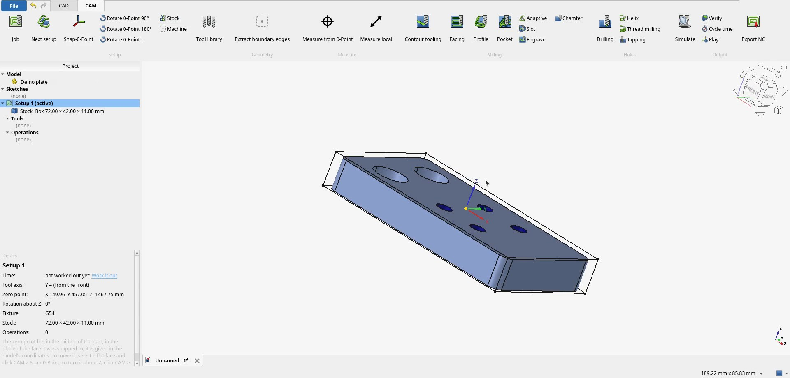

- **Wstążka CAM** (u góry), podzielona na grupy:
  - **Setup:** Job, Next setup, Snap-0-Point, Move 0-Point, Set 0-Point as default, Reset 0-Point, obrót zera, Stock, Custom stock, Tool library;
  - **Geometry:** Extract boundary edges;
  - **Measure:** pomiary;
  - **Milling:** Contour tooling, Facing, Adaptive…;
  - **Holes:** Drilling, Helix, Thread milling;
  - **Output:** Simulate, Verify, Cycle time, FreeCAD sim, Export NC.
- **Drzewo projektu** (po lewej): Model, Sketches, a w każdym Setupie Stock, Tools i Operations.
- **Details** (pod drzewem): opis zaznaczonego elementu. Najważniejsze pola można tu zmienić bez otwierania okna.
- **Widok 3D:** kliknięcie zaznacza ściany, krawędzie i linie szkiców. Czerwona linia to ścieżka narzędzia zaznaczonej operacji.

Każde okno operacji ma przycisk **Manual**, który pokazuje dokładny opis działania tej operacji.

**Obsługa widoku (jak w Blenderze):** środkowy przycisk obraca widok, Shift+środkowy przesuwa, Ctrl+środkowy przybliża.

---

## 2. Setup i Stock

### Setup

Kliknij **Job**. W drzewie pojawia się **Setup 1 (active)**, czyli pierwsze mocowanie, z grupami Stock, Tools i Operations.

Zero jest domyślnie na górze modelu, pośrodku. Żeby je przenieść:

- zaznacz płaską ścianę i kliknij **Snap-0-Point**: oś Z wychodzi ze ściany, a X0 Y0 trafia na środek detalu;
- **Rotate 0-Point 90° / 180° / …** obraca zero wokół osi Z.

#### Przesuwanie zera w obrębie mocowania (eksperymentalne)

> Ta część jest eksperymentalna: nie była jeszcze puszczona na maszynie. Taki program sprawdź w symulacji sterowania i na sucho.

Zero ustawione przez Snap-0-Point to **domyślny punkt zerowy** mocowania, czyli preset maszyny. **Move 0-Point** odsuwa zero od niego, a **każda operacja zostaje przy zerze, na którym powstała**: operacje zrobione przed przesunięciem zostają bez zmian, nowe liczą się od miejsca, w którym zero zostało. W programie zero każdej operacji jest podane względem domyślnego (przesunięcie punktu zerowego, a przy obróconym zerze także pochylona płaszczyzna).

- **Move 0-Point**: w oknie kliknij **Select wall**, a potem płaską ścianę detalu: zero trafia najkrótszą drogą na tę ścianę (ściana prostopadła do X zmienia tylko X; druga ściana dokłada się do pierwszej, więc dwie lub trzy ściany dają narożnik). Albo kliknij **Select circle**, a potem okrągłą krawędź detalu albo ściankę okrągłego otworu lub czopa: zero trafia do środka okręgu na wylocie otworu, tam gdzie narzędzie wchodzi z zewnątrz detalu (klik w głąb otworu, nawet w jego dalszą krawędź, też daje wylot; przy otworze przelotowym w płycie — ten koniec, który kliknąłeś). Możesz też wpisać przesunięcie w polach **Move X / Y / Z**. Widok 3D pokazuje, gdzie zero się znajdzie; **OK** je przesuwa.
- **5 axes** (pole do zaznaczenia w tym oknie), dla maszyny z pochylaniem: przy zaznaczonym **Z out of the model** Select wall dodatkowo obraca oś Z zera na zewnątrz ściany, prostopadle do niej, więc narzędzie staje na tej ścianie, a Select circle obraca Z wzdłuż osi okręgu, na zewnątrz detalu (na stronę bez materiału): otwory w czole rury i duży otwór w jej środku robi się wtedy z głowicą obróconą. Bez 5 axes okno mówi, gdy oś okręgu nie idzie wzdłuż Z; zaznaczenie 5 axes już po kliknięciu od razu obraca zero. **5 axes** i **Z out of the model** zostają zapamiętane na następne otwarcie okna. Pola **Turn about X / Y / Z** obracają zero o wpisane kąty wokół jego własnych osi (najpierw X, potem Y, potem Z, wokół osi w położeniu sprzed obrotu).
- **Set 0-Point as default**: obecne zero staje się domyślnym (presetem).
- **Reset 0-Point**: zero wraca na domyślne.
- **Make 0-Point active** (prawy klik na operacji): zero przechodzi tam, skąd liczy ta operacja, żeby ją zmienić albo dodać tam kolejne. Operacja z innego zera ma w drzewie dopisek *(other 0-Point)*; **Edit…** na niej najpierw uaktywnia jej zero.

Snap-0-Point i Rotate 0-Point przestawiają całe mocowanie (domyślne zero razem z operacjami, które od niego liczą); używaj ich, gdy zero stoi na domyślnym.

**Stock ma własny punkt zerowy**: domyślny. To jeden blok, gdziekolwiek stoi zero. Możesz go zmieniać na każdym zerze: na zerze obróconym o ćwierć obrotu (ściana bloku) okno Stock pokazuje wymiary i naddatki wzdłuż osi, które widzisz, a to, co wpiszesz, jest przeliczane na zero domyślne. Na zerze pod innym kątem blok nie jest pudełkiem wzdłuż widzianych osi, więc okno Stock pokazuje go wzdłuż własnych osi stocka i to mówi; widok 3D rysuje blok tak, jak leży.

Widok 3D, kostka nawigacji i widoki Top / Front / Right zawsze idą za aktywnym zerem.

**Simulate, Verify i Cycle time** puszczają każdą operację z jej własnego zera: narzędzie jest rysowane pochylone tak jak to zero, stock jest zbierany z tej strony, a Verify sprawdza każdą operację z detalem. Gdy jakaś operacja jest na obróconym zerze, puszczany jest program maszyny z pochylaniem (Play pokazuje listę tego programu); inaczej program maszyny wybranej przy ostatnim eksporcie. Drogi obracanej głowicy między operacjami nie ma w programie, więc nie jest rysowana ani liczona do czasu cyklu.

### Stock

Kliknij **Stock** na wstążce. Stock to obrys modelu plus naddatek z każdej strony.

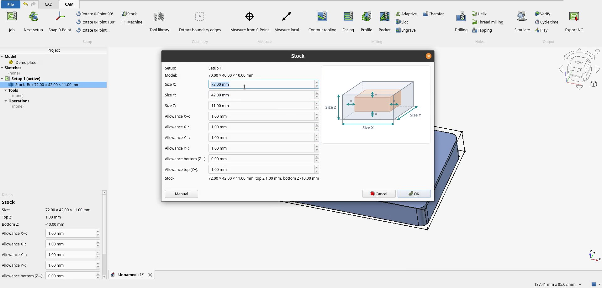

| Pole | Znaczenie |
| --- | --- |
| Size X / Y / Z | Wymiar surowego klocka. Model zostaje pośrodku. |
| Allowance X− / X+ / Y− / Y+ | Naddatek osobno z każdej strony. |
| Allowance bottom (Z−) | Materiał pod modelem (np. do zdjęcia w drugim mocowaniu). |
| Allowance top (Z+) | Materiał nad modelem (do zdjęcia przez Facing). |

Zmiany zapisuje **OK**. W przykładzie stock ma 74,20 × 50,22 × 15,20 mm.

### Custom stock (własny stock z pliku)

Gdy detal robisz z odlewu, ciętego klocka albo surówki obrobionej wcześniej, kliknij **Custom stock** na wstążce (jest też **Custom stock...** w oknie Stock i w Details stocka) i wybierz jego plik STEP, IGES, BREP lub STL. **Put the middle of the stock in the middle of the model** (domyślnie zaznaczone) przesuwa surówkę tak, że środek jej obrysu trafia na środek obrysu modelu — plik może ją rysować gdziekolwiek. Surówka, którą plik już rysuje wokół detalu, zostaje na miejscu (naddatki tam, gdzie dała je odlewnia, np. tylko od spodu). Bez zaznaczenia zawsze zostaje tam, gdzie narysowano ją w pliku (w układzie detalu). Surówka jest tylko przesuwana, nigdy obracana: jeśli model z niej wystaje (za mała albo leży w inną stronę), komunikat mówi, o ile i z której strony. Details pokazują plik i gdzie jest środek surówki; **Put in the middle** ustawia ją na środku później. Prawy klik na Stock w liście otwiera menu: **Move stock...** przesuwa surówkę po osiach X, Y, Z mocowania, **Put in the middle**, **Custom stock...**, **Stock...**. **Replace by box with allowances** wraca do pudełka. Simulate i Verify zaczynają od materiału surówki.

### Biblioteka narzędzi

**Tool library** na wstążce pokazuje narzędzia warsztatu, każdy numer T raz na materiał obrabiany (z własnymi obrotami i posuwami). **Add to project** dodaje zaznaczone do aktywnego mocowania. Pod tabelą:

- **New tool...** otwiera puste narzędzie z najniższym wolnym numerem T. Wybierz **Type**: okno pokazuje rysunek typu z FreeCADa i tylko jego pola, nazwane literami z rysunku (Diameter (D), Corner radius (R), Cutting length (H), Length out of the holder (L), Shank diameter (S), ...). Wpisz obroty i oba posuwy; obok liczą się Vc i fz. **OK** mówi, czego brakuje albo co jest źle, i nie zamyka okna.
- **Edit...** zmienia zaznaczone narzędzie. Gdy otwarty projekt je ma, AvangardeCam pyta, czy zmienić je też tam: jego operacje dostają nową geometrię, obroty i posuwy (własne obroty i posuwy operacji zostają).
- **Duplicate...** kopiuje zaznaczone narzędzie, np. na inny materiał pod tym samym numerem T. Okno pokazuje, co jeszcze jest w bibliotece pod tym numerem.
- **Delete** usuwa zaznaczone narzędzie z biblioteki; projekt zachowuje swoją kopię.

Biblioteka dostarczana z AvangardeCam jest zastępowana przy każdej aktualizacji, więc pierwsza zmiana kopiuje ją do Twojego pliku w folderze użytkownika FreeCADa (`AvangardeCam/tools.json`), używanego od tej pory. Biblioteka otwarta przez **Open other library...** jest zmieniana tam, gdzie leży.

**Narzędzia z Twojego starego programu.** Biblioteka to zwykły plik JSON: jego format jest opisany na początku `avangardecam/model/library.py`, a `Resources/library/tools.json` to pełny przykład. Asystent AI do programowania, np. Claude Code, prawdopodobnie szybko przerobi tabelę narzędzi z Twojego starego programu (jej eksport, CSV albo arkusz) na ten format: daj mu swoją tabelę i te dwa pliki i poproś o bibliotekę narzędzi AvangardeCam. Wynik otwórz przez **Open other library...**; pliku, którego nie da się odczytać, AvangardeCam nie przyjmie i poda powód. Zanim zaczniesz nimi skrawać, sprawdź kilka narzędzi (średnica, długości, obroty i posuwy): **Edit...** i **OK** na narzędziu też powie, co jest z nim nie tak.

---

## 3. Wiercenie z modelu 3D

Otwory wiercisz prosto z modelu. Program sam odczytuje średnicę i głębokość. Powstaje cykl **CYCL 205** (wiercenie z łamaniem wióra).

1. Kliknij ścianę otworu w widoku 3D. Kolejne otwory dodawaj **Shift+klikiem**.
   Kolejność klikania jest kolejnością wiercenia.
2. Kliknij **Drilling**.
3. Wybierz wiertło z listy albo przez **Choose tool…** z biblioteki narzędzi.
   Narzędzie spoza Setupu zostanie do niego dodane.
4. Kliknij **OK**.

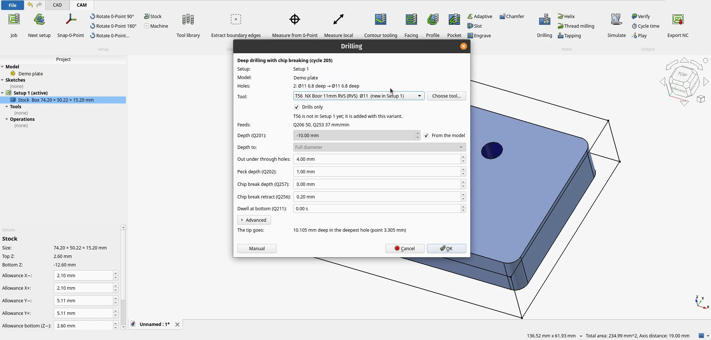

| Pole | Znaczenie |
| --- | --- |
| Depth (Q201) + From the model | Zaznaczone: głębokość każdego otworu brana z modelu. Odznaczone: wpisz głębokość ujemną od góry otworu (−10 = 10 mm w głąb). |
| Out under through holes | O ile wiertło wychodzi pod otworem przelotowym. |
| Peck depth (Q202) | Co ile wiertło wychodzi z otworu (0 = całość naraz). |
| Chip break depth (Q257) | Co ile cofa się, żeby złamać wiór (0 = bez łamania). |
| Chip break retract (Q256) | O ile się cofa przy łamaniu wióra. |
| Dwell at bottom (Q211) | Postój na dnie. |

Wiersz **The tip goes** podaje, jak głęboko zejdzie czubek wiertła, razem z jego stożkiem.

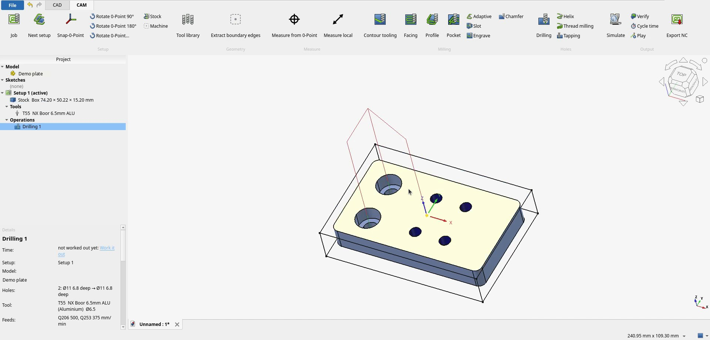

W przykładzie powstały dwie operacje: **Drilling 1** (wiertło Ø6,5 w pogłębieniach) i **Drilling 2** (wiertło Ø5 pod gwinty M6).

---

## 4. Facing — planowanie

Facing zdejmuje naddatek z góry całego stocku, aż do górnej ściany modelu.

1. Kliknij górną ścianę modelu.
2. Kliknij **Facing**.
3. Wybierz frez z płaskim czołem, np. frez czołowy Ø50.

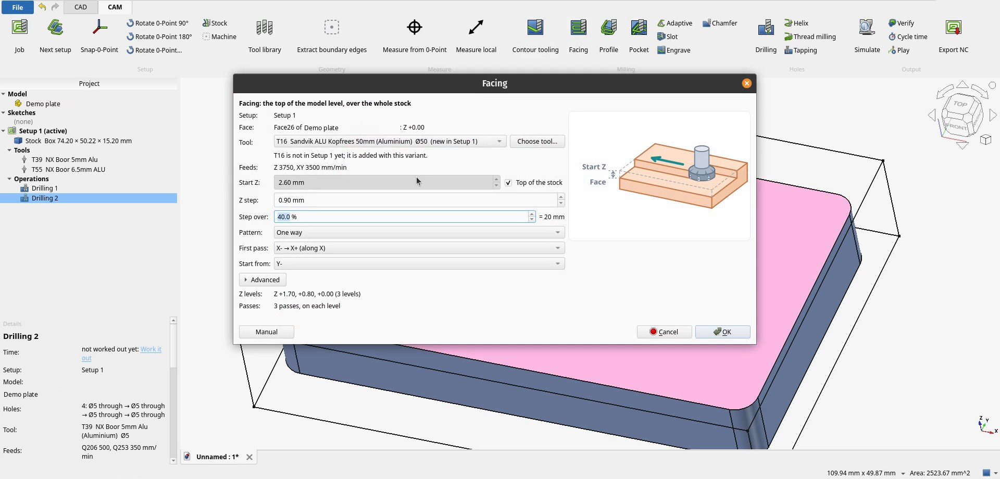

| Pole | Znaczenie |
| --- | --- |
| Start Z + Top of the stock | Gdzie zaczyna się materiał. Zaznaczone: zawsze góra stocku. |
| Z step | Głębokość jednego poziomu. Wiersz *Z levels* pokazuje wynik. |
| Step over | Odstęp między przejściami w % średnicy freza. |
| Pattern | *Zigzag* (tam i z powrotem) albo *One way* (zawsze w jedną stronę). |
| First pass | Kierunek pierwszego przejścia, wzdłuż X albo Y. |
| Start from | Od której krawędzi stocku frez zaczyna. |

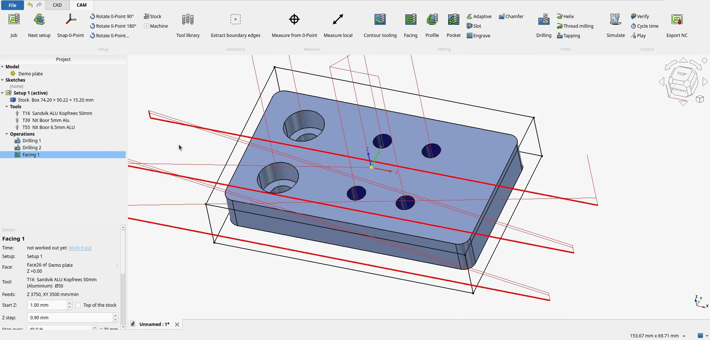

---

## 5. Lista operacji

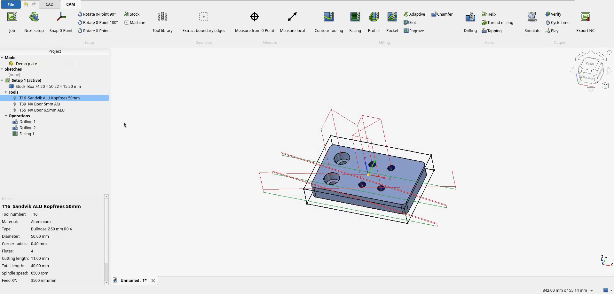

- **Kolejność:** przeciągnij operację myszą w drzewie, np. Facing 1 przed wiercenie.
- **Edycja:** prawy klik → **Edit...** otwiera okno, w którym operacja powstała. Szybkie zmiany zrobisz też w panelu Details.
- **Ukrywanie:** prawy klik → **Hide in 3D**. Operacja jest oznaczona *(hidden)*, a jej ścieżka nie zasłania widoku. Zostaje w programie.
- **Wyłączanie:** prawy klik → **Switch off**. Operacja zostaje na liście, ale nie trafia do programu ani do symulacji.
- **Usuwanie:** prawy klik → Delete.

### Obroty i posuwy

Każde okno operacji ma pod narzędziem pola **Spindle speed**, **Feed XY** i **Feed Z** (wiercenie: **Feed Q206** w dół w otwór i **Feed Q253** do punktu startu). Wypełniają się z wybranego narzędzia i można je zmienić tylko dla tej operacji:

- Zmieniona wartość jest **pogrubiona** i oznaczona *(own)*. **From tool** wraca do wartości narzędzia. Inne narzędzie wpisuje swoje wartości.
- Obok liczone są **Vc** (prędkość skrawania, m/min) i **fz** (posuw na ząb, mm) do sprawdzenia wartości.
- Narzędzie zachowuje swoje wartości; inne operacje tym narzędziem się nie zmieniają. Niezmienione wartości dalej idą za narzędziem.
- Program, Simulate, Verify i czas cyklu biorą wartości operacji. To samo narzędzie z innymi obrotami jest wywołane jeszcze raz pełnym `TOOL CALL`.
- **Change tool...** daje operacji wartości nowego narzędzia. Details pokazuje wartości po narzędziu (*(own)* przy zmienionej).

---

## 6. Symulacja — Simulate

Kliknij **Simulate**. Program aktywnego Setupu jest odtwarzany tak, jak wykona go maszyna: materiał ubywa na żywo.

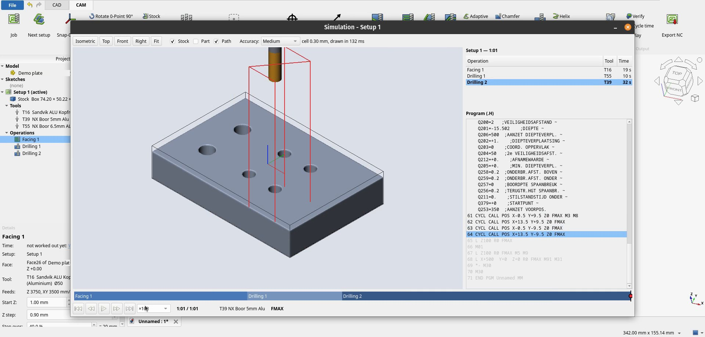

- **Po prawej** jest lista operacji z narzędziem i czasem, a pod nią program `.H`. Podświetlona linia to ta, która jest właśnie wykonywana.
- **Na dole** jest pasek czasu z operacjami: kliknij w nim, żeby przeskoczyć.
- **Przyciski:** start/pauza (spacja), krok w przód i w tył, prędkość od ×0,1 do ×100.
- **U góry:** widoki (Isometric, Top, Front, Right, Fit), pokazywanie Stock / Part / Path i dokładność (Accuracy).

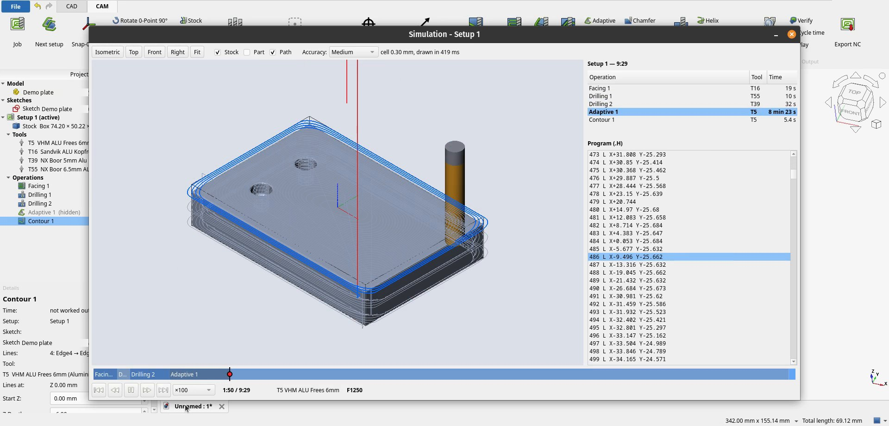

---

## 7. Adaptive clearing

Adaptive usuwa materiał zgrubnie, ze stałym obciążeniem narzędzia: mały odstęp boczny i głębokie przejścia. Nigdy nie wcina się w model.

> **Sprawdź, czy Adaptive działa dobrze.** Okno i Details mówią to na czerwono: przed
> obróbką obejrzyj ścieżkę w **Simulate** albo **Verify**. Czy wszystko jest zebrane i czy
> narzędzie jedzie tylko tam, gdzie powinno?

1. Bez zaznaczania niczego kliknij **Adaptive**: obrabiany jest obszar wokół całego modelu.
   Możesz też zaznaczyć dna, wtedy obrabiany jest tylko ich obszar.
2. Wybierz frez, np. Ø6.

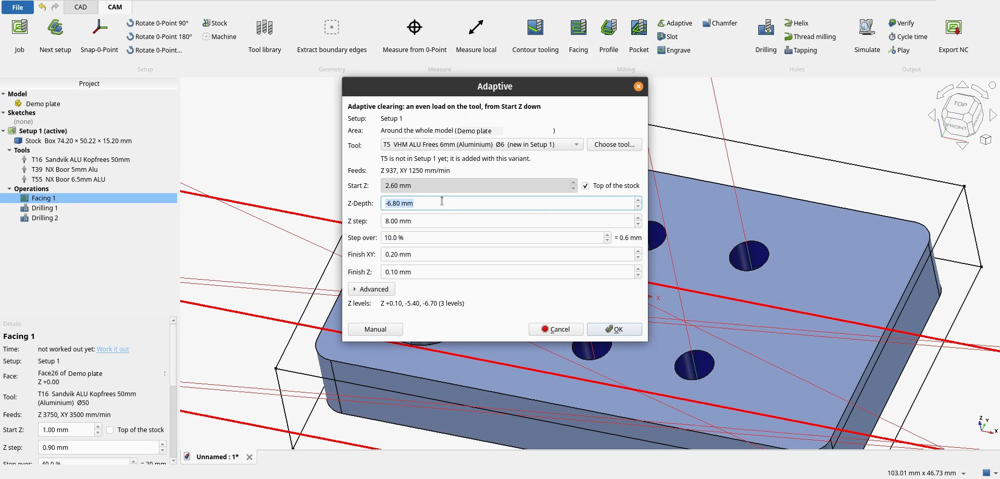

| Pole | Znaczenie |
| --- | --- |
| Start Z + Top of the stock | Skąd zaczyna. Zaznaczone: od góry stocku. |
| Z-Depth | Najniższy poziom. |
| Z step | Głębokość jednego przejścia. Na każdym płaskim dnie modelu jest dodatkowy poziom. |
| Step over | Odstęp boczny w % średnicy. |
| Finish XY / Finish Z | Naddatek zostawiony na ścianach i dnach do wykończenia. |

Wiersz **Z levels** pokazuje wszystkie poziomy.

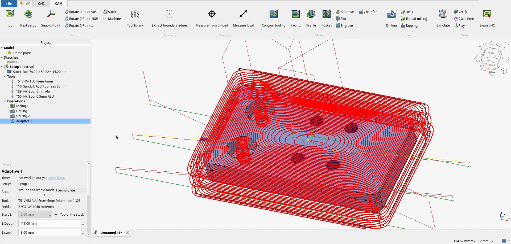

---

## 8. Szkic z krawędzi i wybór linii

Operacje konturowe pracują na liniach szkicu. Szkic robisz jednym kliknięciem.

1. Zaznacz płaską ścianę (np. górę płytki).
2. Kliknij **Extract boundary edges**. W drzewie Sketches pojawia się szkic ze wszystkimi krawędziami tej ściany.

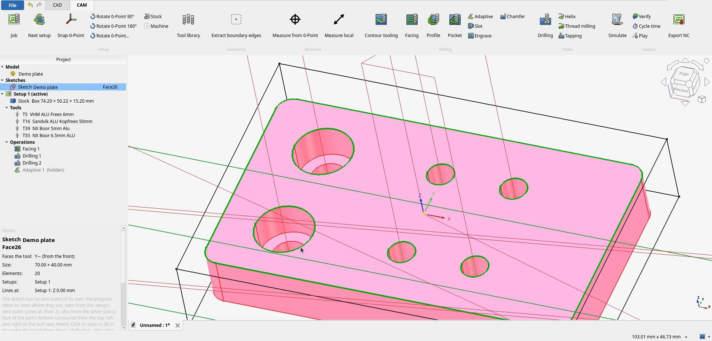

Linie zaznaczasz w widoku 3D jak w Blenderze:

| Kliknięcie | Efekt |
| --- | --- |
| klik | tylko ta linia |
| Shift+klik | dodaj linię (drugi raz: usuń) |
| Ctrl+klik | najkrótsza droga od ostatniej linii do tej |
| Alt+klik | cała zamknięta pętla od tej linii |

Zaznaczone linie mają **strzałki kierunku**. Kliknij strzałkę, żeby odwrócić kierunek.
Kolejność zaznaczania jest kolejnością obróbki.

---

## 9. Contour tooling

Frez jedzie po zaznaczonych liniach, z kompensacją promienia albo środkiem po linii.
Zaznacz linie i kliknij **Contour tooling**. Bez zaznaczenia brane są wszystkie linie szkicu.

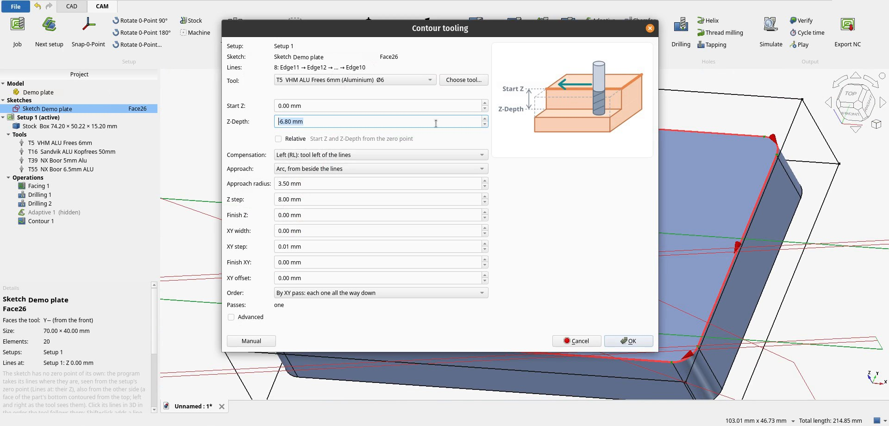

| Pole | Znaczenie |
| --- | --- |
| Start Z | Góra materiału. |
| Z-Depth | Dno konturu. |
| Relative | Zaznaczone: Start Z i Z-Depth liczone od wysokości każdej linii (−1 = 1 mm pod linią). Odznaczone: od zera. |
| Compensation | *Left (RL)* / *Right (RR)*: sterowanie trzyma frez obok linii o promień z tabeli narzędzi. *Off*: środek freza na linii. |
| Approach | *Arc*: wjazd po łuku z boku linii. *None*: prosto w dół na linię. |
| Approach radius | Promień łuku wjazdu (z kompensacją musi być większy niż promień freza). |
| Z step / Finish Z | Głębokość przejścia i naddatek na dnie. |
| XY width / XY step / Finish XY | Szerokość zbierana w XY, krok i przejście wykańczające. |
| XY offset | Przesunięcie środka freza w bok (np. dla freza do fazowania). |
| Order | Kolejność przejść: każde XY do końca w dół albo poziomami. |

Pod **Advanced** są jeszcze:

- **Contour side:** strona linii (RL współbieżnie z M3);
- **Off with arc:** środkiem po linii, ale z wjazdem po łuku;
- **Start / End contour:** wydłużenie (albo skrócenie, wartość ujemna) otwartych linii na początku i na końcu.

### Przykład: cztery kontury płytki

**Contour 1 — pogłębienia.** Linie pogłębień, Z-Depth −6,8 mm.

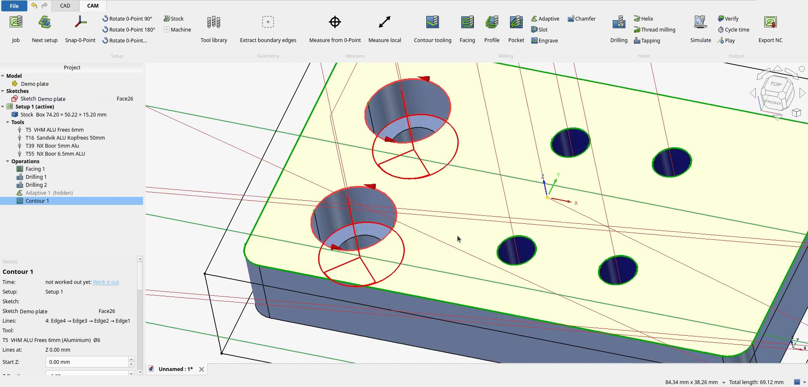

**Contour 2 — obrys zewnętrzny.** Linie obrysu, kompensacja RL, wjazd po łuku.

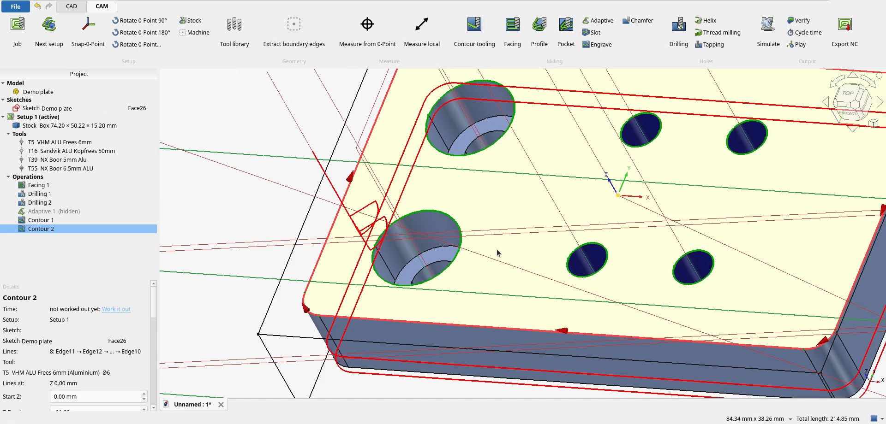

**Contour 3 — gratowanie.** Wszystkie linie, frez do fazowania T29, **Relative** zaznaczone, Z-Depth −1 mm, kompensacja Off i XY offset 0,85 mm (pod Advanced).

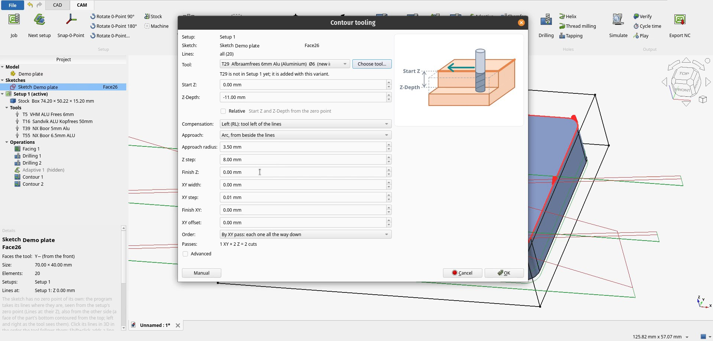

Najedź myszą na **Relative**, żeby zobaczyć podpowiedź:

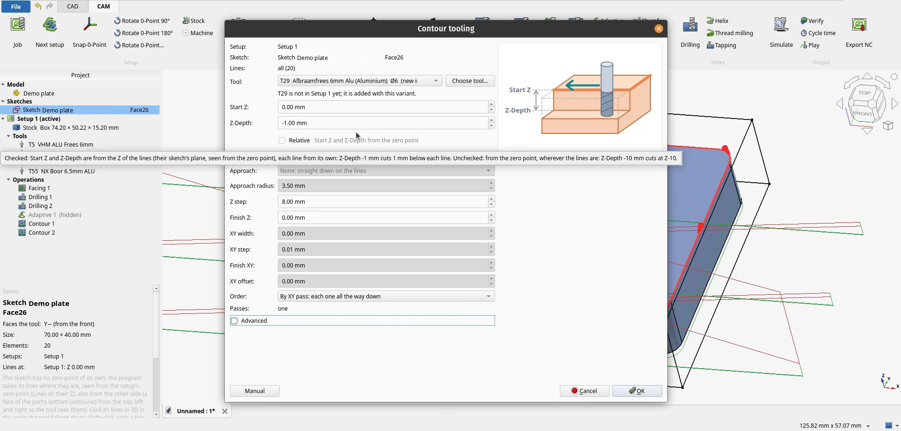

**Contour 4 — krawędzie w dnie pogłębień.** Linie z kilku szkiców naraz (Face20 i Face27). Każda linia jest obrabiana na swojej wysokości.

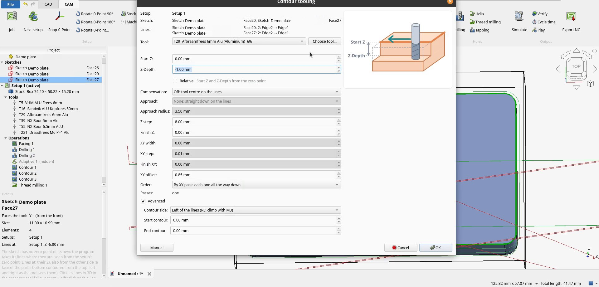

---

## 10. Frezowanie gwintów

1. Shift+klikiem zaznacz otwory w modelu (w kolejności obróbki).
2. Kliknij **Thread milling**.
3. Wybierz frez do gwintów (*Thread mills only*).

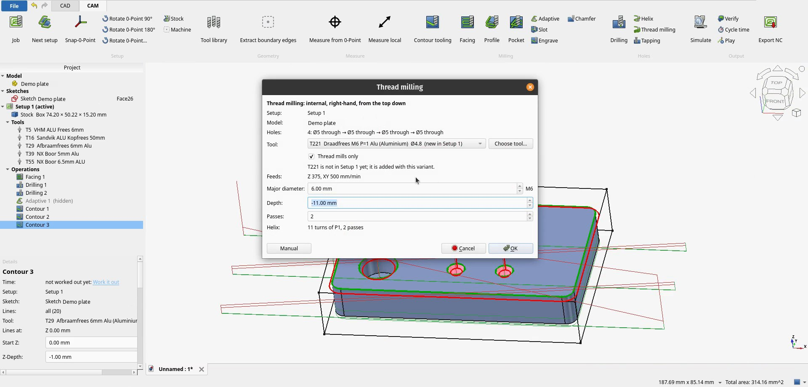

| Pole | Znaczenie |
| --- | --- |
| Major diameter | Średnica nominalna gwintu (M6 = 6 mm). Skok bierze się z freza. |
| Depth | Głębokość ujemna od góry otworu. |
| Passes | Liczba przejść tą samą helisą. |

Frez schodzi do góry otworu, wjeżdża na gwint z kompensacją RR i jedzie helisą w dół zgodnie z ruchem wskazówek zegara (gwint prawy).

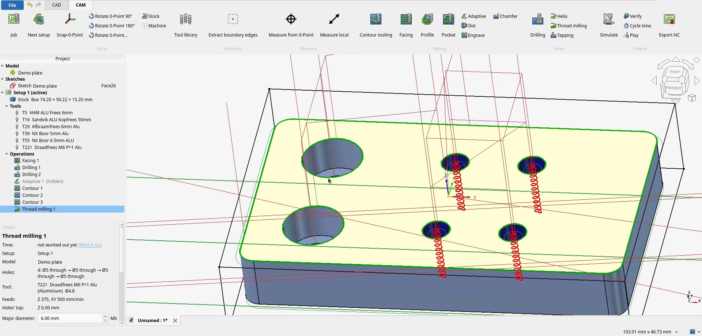

Gotowe mocowanie 1 w symulacji:

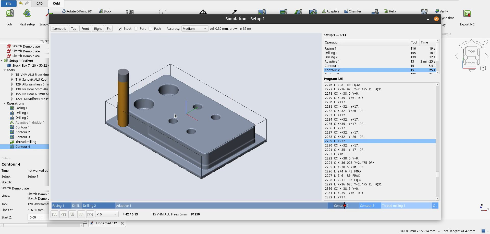

---

## 11. Drugie mocowanie — Next setup

Detal odwracasz, żeby obrobić spód. Kliknij **Next setup**.

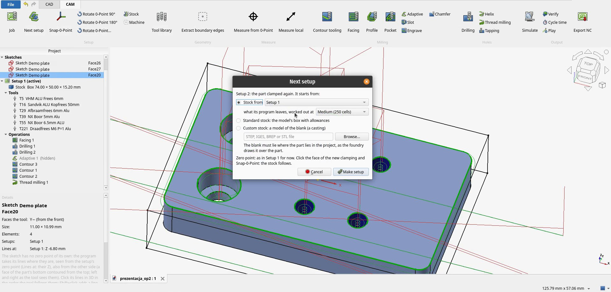

| Opcja | Znaczenie |
| --- | --- |
| Stock from Setup 1 | Startowy materiał to to, co zostaje po programie Setup 1 (wyliczane z dokładnością *Medium* / *Fine*…). |
| Standard stock | Obrys modelu z naddatkami. |
| Custom stock | Model surówki (np. odlewu) z pliku STEP, IGES, BREP lub STL, domyślnie środkiem na środku modelu (patrz [Custom stock](#custom-stock-własny-stock-z-pliku)). |

Kliknij **Make setup**. Powstaje **Setup 2 (active)**.

### Zero dla drugiej strony

Zero jest na razie takie jak w Setup 1. Kliknij ścianę, która teraz jest na górze (spód detalu), a potem **Snap-0-Point**. Stock podąża za zerem.

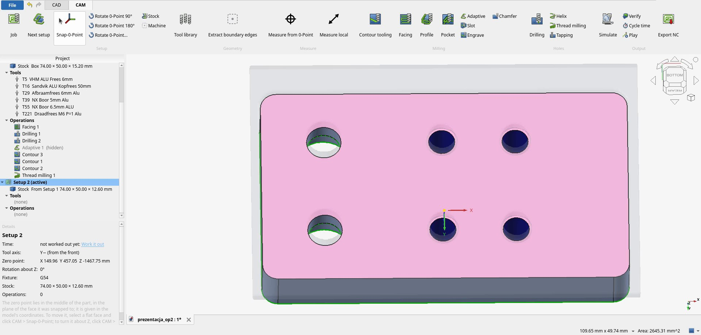

### Obróbka od spodu

Dalej pracujesz jak w mocowaniu 1:

- **Facing 2:** planowanie naddatku od spodu;

  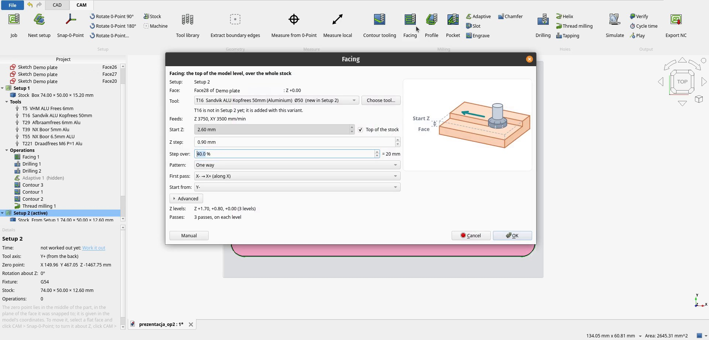

- **Extract boundary edges** na dolnej ścianie i **Contour tooling** z frezem do fazowania: gratowanie spodu.

  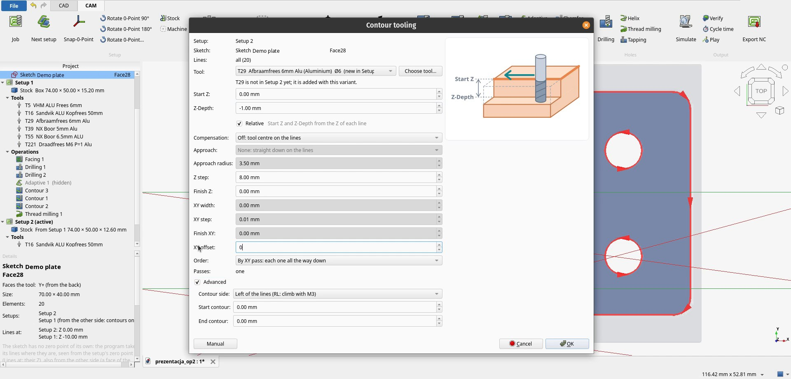

Symulacja Setup 2 zaczyna od materiału, który został po Setup 1:

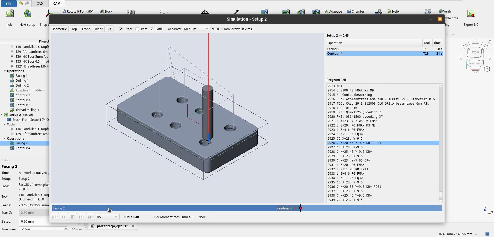

---

## 12. Program NC i kontrola

| Przycisk | Co robi |
| --- | --- |
| **Simulate** | Odtwarzanie programu jak na maszynie (rozdział 6). |
| **Verify** | Program aktywnego Setupu wycięty ze stocku. Na czerwono: za głęboko w detal. Na niebiesko: zostawiony materiał. Pokazuje też szybkie ruchy w materiale. |
| **Cycle time** | Czas każdej operacji i Setupu w tabeli, liczony z dynamiki maszyny. |
| **FreeCAD sim** | Symulator FreeCADa: operacje aktywnego Setupu obrabiają jego stock. |
| **Export NC** | Program Heidenhain (`.H`), każdy Setup na własnym presecie. Maszynę wybierasz jako typ pliku w oknie eksportu. |

> Postprocesor **Bridgeport V1000** (TNC 620) jest zrobiony i sprawdzony na tej maszynie. Przy innej maszynie dokładnie sprawdź pierwsze programy. Przesunięte zero pisze jako przesunięcie punktu zerowego (`CYCL DEF 7`, eksperymentalnie), a obróconego odmawia.
>
> Postprocesor **Soraluce T35** (obracana głowica) jest eksperymentalny i nie był jeszcze puszczony na maszynie. Każdą operację pisze osobno: etykiety RESET i FREE, wywołanie narzędzia, przesunięcie zera (`CYCL DEF 7`), `PLANE SPATIAL` z kątami zera i cykl głowicy. Programy z jednym kątem (ściana bloku) są wzorowane na programach warsztatu; programy z kilkoma kątami sprawdzaj szczególnie uważnie.
